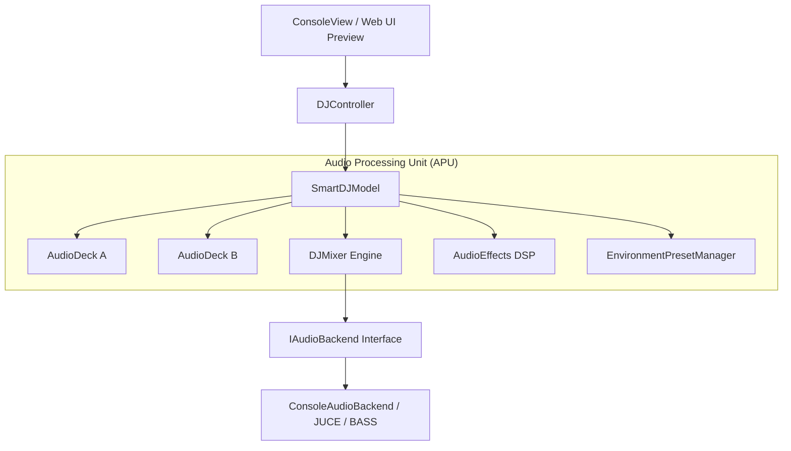

# 🎧 Smart DJ MediaHub — Modern C++17 Audio Engine & DJ Mixer

> **Enterprise C++ Audio Architecture**: Dual-Deck DJ Controller, Real-Time Audio DSP Simulation, Multi-Band Equalizers, Auto Beatmatching, and Dynamic Transition Engine.

---

## 🏛️ System Architecture



---

## 🌟 Key Features

1. **Dual Audio Deck Engine (`AudioDeck`)**:
   - Independent playback, volume scaling, time stretching, and pitch modulation.
   - Dual-buffer track loading and BPM detection.

2. **Automated Beatmatching & Sync Engine**:
   - Real-time time-stretching calculation to seamlessly lock Deck B's BPM to Deck A.

3. **Audio DSP & Environmental Effects (`AudioEffects`)**:
   - Multi-band Parametric EQ (Low, Mid, High shelving filters).
   - Reverb, Echo, Low-Pass filter sweeps, and High-Pass transitions.
   - Acoustic presets: *Club*, *Concert Hall*, *Studio*, *Arena*.

4. **Dynamic Energy Drop & Equal-Power Crossfader**:
   - Build-up tension filters with progressive low-pass resonance.
   - Trigonometric equal-power crossfade curve ensuring zero volume drop during transitions.

5. **Clean Architecture & SOLID Principles**:
   - Strict Model-View-Controller (MVC) decoupling.
   - Dependency Inversion via `IAudioBackend` abstraction, enabling plug-and-play drivers (Console Audio Backend, JUCE, or BASS engine).

---

## 🛠️ Building & Running

### Requirements
- C++17 compatible compiler (GCC 9+, Clang 10+, or MSVC 2019+)
- CMake 3.16+

### Quick Build (CMake)
```bash
mkdir build && cd build
cmake ..
cmake --build .
./SmartDJ
```

### Direct Compilation (g++)
```bash
g++ -std=c++17 -O2 -Iinclude src/main.cpp src/audio/*.cpp src/controller/*.cpp src/model/*.cpp src/view/*.cpp -o SmartDJ
./SmartDJ
```

---

## 📂 Project Structure

```text
├── include/
│   ├── audio/        # AudioDeck, DJMixer, AudioEffects, Presets, Backends
│   ├── controller/   # DJController (Mediator & Workflow Orchestrator)
│   ├── model/        # SmartDJModel (State & Core Engine)
│   └── view/         # ConsoleView & IPlayerView Interface
├── src/              # Full C++17 Implementations
├── preview/          # Interactive Web UI Demonstration
├── CMakeLists.txt    # Modern CMake Build System
└── README.md
```
